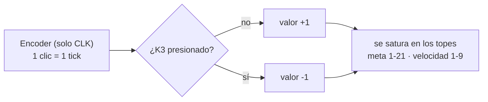
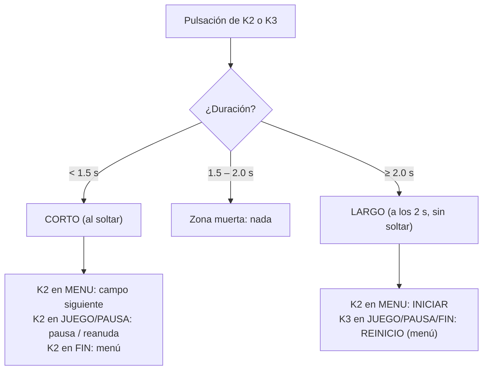
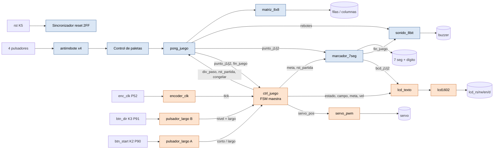
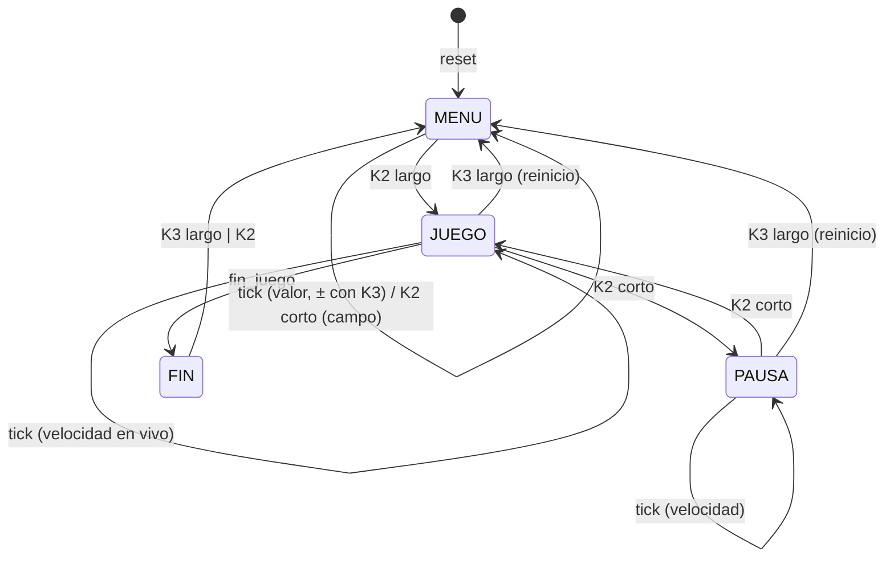
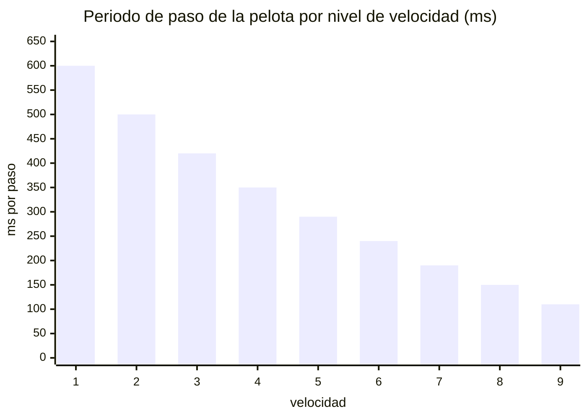
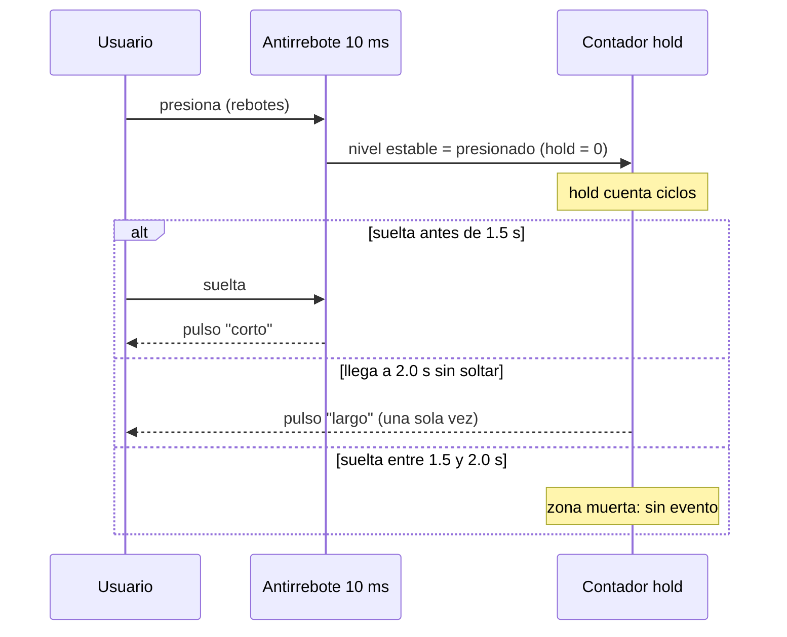
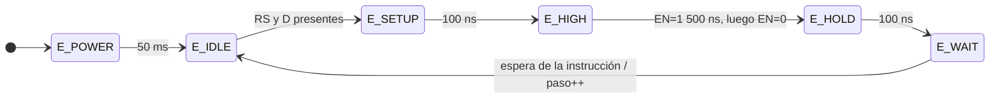
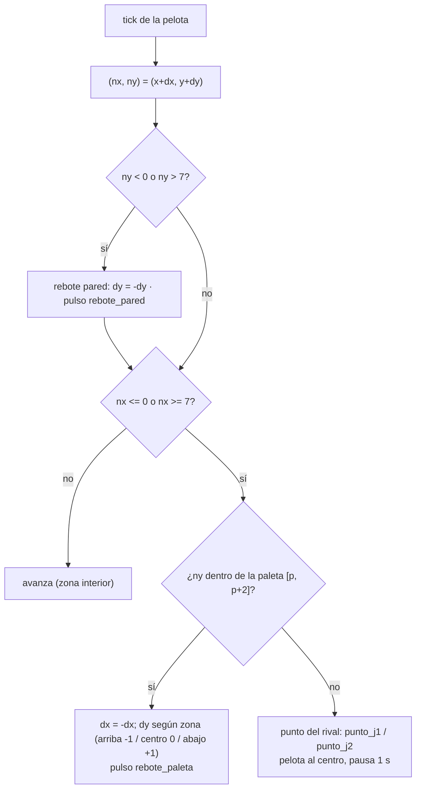
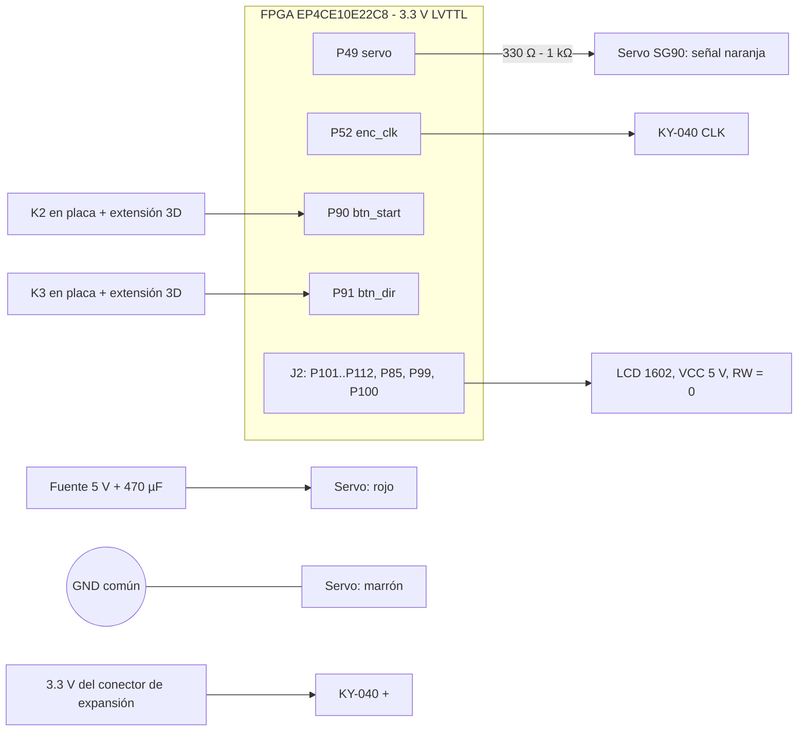

# FPONGA V2 — Pong en FPGA con menú LCD, encoder rotativo y servomotor

**Tarjeta:** A-C4E6E10 · **FPGA:** Cyclone IV `EP4CE10E22C8` · **Reloj:** 50 MHz · **HDL:** Verilog-2001 · **Quartus:** 23.1 Lite
**Autores:** Luisa Fernanda Capera Velosa · Santiago Camargo Molina · David Felipe Ruiz Reyes— Electrónica Digital I, Universidad Nacional de Colombia (docente: Johan Sebastian Eslava Garzón)

> **Sin soldar nada a la tarjeta.** El encoder solo entrega la línea CLK (P52); DT y SW no se usan. Las demás funciones están en los botones K2 y K3 de la tarjeta, que se prolongan con piezas impresas en 3D hasta la caja. Los interruptores DIP no se tocan.

> **Resumen.** Pong de dos jugadores en una FPGA Cyclone IV, con matriz LED 8×8, marcador de 7 segmentos y sonido, ampliado con un menú en pantalla LCD 1602 para elegir el marcador final y la velocidad, un encoder rotativo KY-040 (solo la línea CLK), dos botones de la tarjeta para iniciar, pausar y reiniciar, y un servomotor que señala al ganador. El diseño completo está explicado en este README y en el informe.

---

## Índice
1. [Qué hace](#1-qué-hace)
2. [Arquitectura](#2-arquitectura)
3. [Máquina de estados maestra](#3-máquina-de-estados-maestra)
4. [Módulos nuevos al detalle](#4-módulos-nuevos-al-detalle)
5. [Módulos de la V1 (conservados)](#5-módulos-de-la-v1-conservados)
6. [Lógica secuencial vs. combinacional](#6-lógica-secuencial-vs-combinacional)
7. [Pines, pull-ups y cableado](#7-pines-pull-ups-y-cableado)
8. [Cambios al código existente](#8-cambios-al-código-existente)
9. [Parámetros](#9-parámetros)
10. [Simulación y GTKWave](#10-simulación-y-gtkwave)
11. [Síntesis en Quartus](#11-síntesis-en-quartus)
12. [Decisiones de diseño](#12-decisiones-de-diseño)
13. [Estructura del repositorio](#13-estructura-del-repositorio)

---

## 1. Qué hace

| Elemento | Función |
|---|---|
| Matriz LED 8×8 | Campo: 2 paletas de 3 LED y la pelota |
| 4 displays de 7 seg | Marcador J1 y J2 (2 dígitos c/u) |
| 4 pulsadores | Paletas arriba/abajo de cada jugador |
| Buzzer | Rebotes y melodía de victoria |
| **LCD 1602** *(nuevo)* | Menú (marcador final, velocidad, iniciar) y estado de juego |
| **KY-040** *(nuevo, solo CLK)* | Cada clic = un *tick*: cambia el valor del campo / la velocidad en vivo |
| **K2 = botón A** *(nuevo)* | Menú: corto = campo siguiente, **largo (2 s) = iniciar** · Juego: corto = pausa / reanuda |
| **K3 = botón B** *(nuevo)* | **Dirección:** suelto = el tick sube, presionado = baja · **largo (2 s) = reinicio** (sale al menú) |
| **Servo** *(nuevo)* | Siempre inicia a 90°; al ganar J1 → 0°, J2 → 180° (parámetro) |

### Controles





| Botón | MENU | JUEGO | PAUSA | FIN |
|---|---|---|---|---|
| **Encoder** (tick) | ± valor del campo | ± velocidad | ± velocidad | — |
| **K2 corto** | campo siguiente | pausa | reanuda | → MENU |
| **K2 largo (2 s)** | **inicia** | — | — | → MENU |
| **K3 presionado** | el tick **baja** | el tick **baja** | el tick **baja** | — |
| **K3 largo (2 s)** | — | **reinicio → MENU** | **reinicio → MENU** | → MENU |

**K3 como modificador:** si durante la pulsación de K3 se giró el encoder, su pulsación larga **no** cuenta como reinicio (registro `b_usado`); así se puede bajar la velocidad manteniendo K3 más de 2 s sin perder la partida.

Pantallas de la LCD (16×2):

```text
MENU, campo=MARCADOR      MENU, campo=VELOCIDAD     MENU, campo=INICIAR
>Marcador fin:10          _Marcador fin:10          K2 2s = INICIAR
_Vel:4__Iniciar?          >Vel:4__Iniciar?          _Vel:4_>Iniciar?

JUEGO                     PAUSA                     FIN
J1:05 J2:13 M:21          J1:05 J2:13 M:21          J1:10 J2:08 M:10
Vel:4  JUGANDO            Vel:7  PAUSA              GANA J1!  Vel:7
```
(`_` = espacio; el marcador `>` indica el campo activo.)

La ROM del HD44780 no tiene "¿", por eso se escribe "Iniciar?".

---

## 2. Arquitectura

Azul = existente (V1) · naranja = nuevo (V2).



**Principios globales:** un único reloj de 50 MHz; ningún reloj derivado (solo contadores que producen habilitaciones de un ciclo); toda entrada física pasa por sincronizador de 2 FF; los eventos entre módulos son **pulsos de un ciclo**; las salidas físicas están registradas.

---

## 3. Máquina de estados maestra

`ctrl_juego.v` — FSM de **Moore**; *siguiente estado* combinacional (`function siguiente`) y estado secuencial.



Salidas de Moore:

| Estado | `rst_partida` | `congelar` | `servo_pos` | Tick del encoder |
|---|:-:|:-:|---|---|
| MENU | 1 | 1 | 90° | cambia meta (1–21) o velocidad (1–9) según el campo |
| JUEGO | 0 | 0 | 90° | velocidad en vivo |
| PAUSA | 0 | 1 | 90° | velocidad |
| FIN | 0 | 1 | 0° (gana J1) / 180° (gana J2) | — |

Prioridad de eventos: **reinicio (K3 largo) > fin_juego > pausa**. Campos del menú: `MARCADOR → VELOCIDAD → INICIAR → MARCADOR`. Al volver al menú el campo vuelve a MARCADOR. El **ganador es el último que anotó** (`ult_j1`).

### Tabla velocidad → período de paso



| Nivel | 1 | 2 | 3 | **4 (defecto)** | 5 | 6 | 7 | 8 | 9 |
|---|---|---|---|---|---|---|---|---|---|
| ms/paso | 600 | 500 | 420 | **350** | 290 | 240 | 190 | 150 | 110 |
| ciclos @50 MHz | 30 M | 25 M | 21 M | 17.5 M | 14.5 M | 12 M | 9.5 M | 7.5 M | 5.5 M |

---

## 4. Módulos nuevos al detalle

### 4.1 `encoder_clk` — un tick por clic (solo CLK)

```text
enc_clk (pin)   ‾‾‾\_/\_/‾\______________________/‾\_/\_/‾‾‾‾   (rebotes)
sincronizada    ‾‾‾\_/\_/‾\______________________/‾\_/\_/‾‾‾‾
filtrada (1 ms) ‾‾‾‾‾‾‾‾‾‾‾\______________________________/‾‾
tick            ___________|‾|_________________________________   1 ciclo (20 ns)
```

* Sincronizador de 2 FF + **filtro de estabilidad** (`ENC_FILTRO = 50 000` ciclos = 1 ms).
* `tick` = pulso de 1 ciclo **solo en el flanco de bajada** del valor filtrado (el de subida y los rebotes < 1 ms no hacen nada).
* **Sentido:** no se puede leer de una sola línea; lo decide `ctrl_juego`: `giro_mas = tick & ~K3`, `giro_menos = tick & K3`.
* Cada clic del KY-040 entrega un flanco de bajada de CLK; el módulo toma ese flanco como un *tick*.
* `encoder_ky040.v` (cuadratura completa con CLK y DT) se conserva en `rtl/` **fuera** del proyecto Quartus por si algún día se puede cablear DT; su banco `tb_encoder` sigue disponible.

### 4.2 `pulsador_largo` — corto / largo (K2 y K3)



La salida `nivel` (botón presionado, ya filtrado) se usa en K3 como **dirección**.

### 4.3 `servo_pwm` — PWM de 50 Hz con rampa

| Posición (`pos`) | Ángulo | Ton | Ciclos @50 MHz |
|---|---|---|---|
| 0 | 90° (centro, **al reset**) | 1.5 ms | 75 000 |
| 1 | 0° | 0.5 ms | 25 000 |
| 2 | 180° | 2.5 ms | 125 000 |

* Período 20 ms = 1 000 000 ciclos (contador de 20 bits). Salida `pulso <= (contador < ton)` registrada.
* `ton` **solo cambia al inicio del período** → nunca hay pulsos cortados.
* **Rango completo del servo:** 0.5 a 2.5 ms (no 1 a 2 ms, que solo cubre ~90° del recorrido). Si el brazo roza el tope mecánico en los extremos (zumbido o calentamiento), se ajusta sin tocar la lógica con `T0_US` y `T180_US` de `servo_pwm` (por ejemplo 600 y 2400).
* **Rampa:** `PERIODOS_BARRIDO=80` → paso de 1 250 ciclos/período = 2.25°/período → 180° en 1.6 s (90° en 0.8 s).

```text
 0°   ┌┐____________________   Ton = 0.5 ms
 90°  ┌──┐__________________   Ton = 1.5 ms
 180° ┌────┐________________   Ton = 2.5 ms
      |<------ 20 ms ------>|
```

### 4.4 `lcd_texto` + `lcd1602` — pantalla

* `lcd_texto`: **combinacional puro**; arma 2×16 caracteres (2 vectores de 128 bits) según `estado`, `campo`, `meta`, `vel` y los BCD de los puntajes.
* `lcd1602`: FSM secuencial, bus de 8 bits, **solo escritura** (`RW=0` fijo → ningún 5 V entra a la FPGA), **sin leer busy flag** (espera el tiempo máximo de cada instrucción) y **refresco continuo** de las 32 posiciones (~1.7 ms por cuadro).

Secuencia `paso`:

| paso | Contenido | Espera |
|---|---|---|
| (power) | tras alimentar | 50 ms |
| 0 | `0x38` function set (8 bits, 2 líneas, 5×8) | 5 ms |
| 1–3 | `0x38`, `0x38`, `0x38` | 150 µs c/u |
| 4 | `0x08` display OFF | 150 µs |
| 5 | `0x01` clear | 3 ms (máx. HD44780: 1.52 ms) |
| 6 | `0x06` entry mode +1 | 150 µs |
| 7 | `0x0C` display ON | 150 µs |
| 8 | `0x80` dirección línea 1 | 50 µs |
| 9–24 | 16 caracteres de la línea 1 | 50 µs c/u |
| 25 | `0xC0` dirección línea 2 | 50 µs |
| 26–41 | 16 caracteres de la línea 2 → vuelve al paso 8 | 50 µs c/u |

Sub-FSM de cada byte:



Tiempos (hoja de datos → diseño): setup ≥ 40 ns → 100 ns · EN alto ≥ 230 ns → 500 ns · mantenimiento ≥ 10 ns → 100 ns · instrucción 37 µs → 50 µs. Convertidos a ciclos con `ns2cic()` (64 bits, redondeo hacia arriba).

---

## 5. Módulos de la V1 (conservados)

| Módulo | Qué hace | Notas de implementación |
|---|---|---|
| `antirrebote` | 2 FF + contador de 10 ms (`MAX=499 999`); pulso de 1 ciclo en el flanco 1→0 estable | Un valor nuevo solo se acepta si dura 10 ms |
| Sincronizador de reset | 2 FF iniciados en 1 | Nace en reset; se libera síncrono |
| Paletas | Registro de 3 bits (0..5), Δ∈{-1,0,+1} con saturación | Ambos botones a la vez = ignorar; reset → posición 2 |
| `pong_juego` | Pelota `(x,y)`, `(dx,dy)`; `x∈[1,6]`, `y∈[0,7]` | FSM temporal Movimiento / Pausa(1 s) / Fin |
| `matriz_8x8` | Barrido de filas con blanking | Fila = 6 250 ciclos (125 µs) → cuadro 1 kHz; columnas en ciclo 100, fila en ciclo 200 |
| `marcador_7seg` | BCD 00–99 por jugador; multiplexado 4 kHz (1 kHz/dígito) | Ganador parpadea; polaridad en un registro de salida |
| `sonido_8bit` | Cuadrada 50 %, `f = f_clk / (2·medio)` | Pared 500 Hz/30 ms · paleta 1 kHz/40 ms · victoria 523/659/784/1047 Hz |

Colisiones de la pelota (todo combinacional en un ciclo, se registra el resultado):



---

## 6. Lógica secuencial vs. combinacional

| Módulo | Combinacional | Secuencial |
|---|---|---|
| antirrebote / pulsador_largo | comparación `s2` vs. estable; `nivel = ~estable` | 2 FF, contador 10 ms, `hold`, `disparado` |
| encoder_clk | `giro_mas/menos = tick & K3` | sincronizador, filtro de 1 ms, flanco → `tick` |
| ctrl_juego | `siguiente()`, `ms_paso()`, `congelar` | `estado`, `campo`, `meta`, `vel`, `ult_j1`, `servo_pos`, `rst_partida` |
| servo_pwm | selección de objetivo, `contador < ton` | contador de período, `ton`, `pulso` |
| lcd_texto | **todo** | — |
| lcd1602 | `byte_paso()`, `ns2cic()` (elaboración) | sub-FSM, contador, `paso` |
| paletas / pelota | decodificador, sumador, colisiones | posición, dirección, FSM temporal |
| matriz / marcador | imagen de fila, BCD→7 seg | contador de barrido, selector, BCD, parpadeo |

---

## 7. Pines, pull-ups y cableado

### 7.1 Asignación completa

| Señal | Dir. | Pin(es) FPGA | Elemento |
|---|:-:|---|---|
| `clk` | E | P23 | Reloj de 50 MHz |
| `rst` | E | P86 | K5 (activo en bajo, pull-up) |
| `j1_arriba` / `j1_abajo` | E | P54 / P58 | Pulsadores J1 |
| `j2_arriba` / `j2_abajo` | E | P89 / P88 | Pulsadores J2 |
| `filas[0…7]` | S | P51, 46, 43, 50, 28, 38, 31, 33 | Matriz (filas, activas en alto) |
| `columnas[0…7]` | S | P30, 32, 39, 55, 42, 44, 53, 34 | Matriz (columnas, activas en bajo) |
| `siete_seg[0…6]` | S | P127, 126, 125, 124, 121, 120, 119 | Segmentos |
| `digito_sel[0…3]` | S | P135, 136, 128, 129 | Selección de dígito |
| `buzzer` | S | P141 | Buzzer |
| **`servo`** | S | **P49** | Señal del servo (conector de expansión) |
| **`enc_clk`** | E | **P52** | KY-040 CLK (conector de expansión) — **único pin del encoder** |
| **`btn_start`** | E | **P90** | **K2** = botón A (inicio / selector / pausa) |
| **`btn_dir`** | E | **P91** | **K3** = botón B (dirección / reinicio) |
| **`lcd_d[0…7]`** | S | P101, 103, 104, 105, 106, 110, 111, 112 | LCD D0…D7 (J2) |
| **`lcd_rs`** | S | **P85** | LCD RS |
| **`lcd_rw`** | S | **P99** | LCD RW (siempre 0) |
| **`lcd_en`** | S | **P100** | LCD EN |

Total: 49 pines, sin duplicados.

**Por qué esos pines.** De los pines libres del conector de expansión solo quedaban **P49 y P52**; por la prioridad pedida (servo > encoder > botón) son del servo y de la línea CLK del encoder. Como **no se puede soldar nada a la tarjeta** (los interruptores DIP usan caminos de la PCB), DT y SW del encoder **no se usan**; sentido y funciones de inicio/selección/pausa/reinicio pasan a los botones **K2 (P90)** y **K3 (P91)**, que se prolongan con piezas impresas en 3D hasta la caja. No se usan los DIP (SW1 además comparte P58 con `j1_abajo`).

### 7.2 Estándares eléctricos y pull-ups

* Todos los pines usan `3.3-V LVTTL` (predeterminado del dispositivo), salvo `digito_sel`, que conserva los 2.5 V de las primeras pruebas. Entradas nuevas (`enc_clk`, `btn_start`, `btn_dir`): `WEAK_PULL_UP_RESISTOR = ON` para que nunca floten. K2/K3 son botones de la tarjeta que cierran a GND (activos en bajo).
* El módulo KY-040 trae sus propias resistencias *pull-up* (típicamente 10 kΩ) hacia su pin "+". → **alimentarlo con 3.3 V**, no con 5 V. DT y SW quedan sin conectar.
* Pulsadores V1: activos en bajo con *pull-up* (con resistencias en serie y de pull-up hacia 3.3 V).
* LCD: VDD a 5 V; con `RW=0` el LCD no maneja el bus; las salidas de 3.3 V de la FPGA superan el nivel alto (~2.2 V) del HD44780 a 5 V. Conexión de los 16 pines en la [sección 7.4](#74-lcd-1602-en-j2-los-16-pines).
* Servo: **fuente externa de 5 V**, **GND común** con la FPGA, condensador de ~470 µF junto al servo, resistencia de 330 Ω–1 kΩ en serie con la señal. *(Recomendaciones de diseño, no medidas.)*

### 7.3 Cableado de los periféricos nuevos



### 7.4 LCD 1602 en J2 (los 16 pines)

J2 es el conector hembra de 16 pines de la tarjeta donde se enchufa la LCD 1602 con el pinout estándar del módulo. La tira de 16 pines macho se suelda **al módulo de la LCD** (no a la FPGA) y se enchufan los 16 en J2, con el pin 1 en el lado del pin 1.

| Pin LCD | Nombre | Conexión |
|:-:|---|---|
| 1 | VSS | GND de la tarjeta |
| 2 | VDD | 5 V de la tarjeta |
| 3 | VO | Contraste (potenciómetro o divisor de la tarjeta) |
| 4 | RS | FPGA `PIN_85` |
| 5 | RW | FPGA `PIN_99` (siempre 0) |
| 6 | E | FPGA `PIN_100` |
| 7–14 | D0–D7 | FPGA `PIN_101, 103, 104, 105, 106, 110, 111, 112` |
| 15 | A | Ánodo de la luz de fondo (5 V con resistencia, en la tarjeta) |
| 16 | K | Cátodo de la luz de fondo (GND) |

Solo RS, RW, E y D0–D7 (11 señales) llegan a la FPGA y son las únicas que importan en el código. La alimentación (VSS, VDD), la luz de fondo (A, K) y el contraste (VO) los resuelve la tarjeta a través de J2. Si se usara la LCD fuera de J2, VSS y K van a GND, VDD y A (con resistencia) a 5 V y VO a un potenciómetro de 10 kΩ que ajusta el contraste.

Caja: modelo 3D en `docs/informe/figuras/caja_3d.png` (la orientación del brazo, cuál lado es 0° y cuál 180°, se ajusta con `J1_SERVO_A_0`).

---

## 8. Cambios al código existente

Se modificó **lo mínimo indispensable**; todo está marcado `// [V2]` y detallado con diff en [`CAMBIOS_CODIGO_EXISTENTE.md`](CAMBIOS_CODIGO_EXISTENTE.md).

| # | Módulo | Cambio | Motivo |
|---|---|---|---|
| 1 | `pong_top` | Puertos/parámetros nuevos; `PUNTOS_GANAR` = valor por defecto | Integración |
| 2 | `pong_top` | `reset_partida = reset \| rst_partida`; paletas bloqueadas con `congelar` | Volver al menú reinicia; pausa |
| 3 | `pong_juego` | Entrada `div_paso`, contador a 26 bits, `>=` en vez de `==` | Velocidad configurable y en vivo |
| 4 | `pong_juego` | Recibe `fin_juego \| congelar` | Pausa reutilizando su lógica |
| 5 | `marcador_7seg` | `PUNTOS_GANAR` → entrada `meta[4:0]` en ejecución; salidas `bcd_j1/j2` | Meta configurable; datos para la LCD |

Sin cambios: `antirrebote`, `matriz_8x8`, `sonido_8bit`, `decodificador_7seg`.

---

## 9. Parámetros

| Parámetro | Defecto | Significado |
|---|---|---|
| `PAUSA_DIV` | 50 000 000 | 1 s de pausa tras un punto |
| `DEBOUNCE_MAX` | 499 999 | 10 ms |
| `SCAN_DIV` | 6 250 | 125 µs por fila de la matriz |
| `CAMBIO_HZ` | 4 000 | 1 kHz por dígito |
| `PARPADEO_DIV` | 12 500 000 | parpadeo del ganador (250 ms) |
| `PUNTOS_GANAR` | 10 | marcador final **por defecto** (1–21) |
| `VEL_DEF` | 4 | 350 ms/paso |
| `T_CORTO_MS` / `T_LARGO_MS` | 1500 / 2000 | límites de pulsación |
| `ENC_FILTRO` | 50 000 | filtro del CLK del encoder, 1 ms |
| `J1_SERVO_A_0` | 1 | 1: gana J1 → 0°, gana J2 → 180° |
| `SERVO_BARRIDO` | 80 | períodos de 20 ms para 180° (0 = sin rampa) |

---

## 10. Simulación y GTKWave

Requisitos: `iverilog`, `vvp`; opcional `gtkwave`, `xvfb`.

```bash
cd sim
bash run_all.sh            # compila y corre todos los testbenches (tb_servo_pwm tarda ~3 min)
bash run_all.sh waves      # además regenera capturas de GTKWave en docs/fig/
gtkwave out/tb_sistema.vcd wave/tb_sistema.gtkw      # abre con señales rotuladas
```

| Banco | Verifica |
|---|---|
| `tb_encoder_clk` | clic con rebotes → 1 tick; glitch < 1 ms ignorado; 5 clics rápidos → 5 ticks |
| `tb_encoder` *(opcional)* | cuadratura completa CW/CCW (no se usa en V2.1) |
| `tb_pulsador_largo` | corto (<1.5 s), zona muerta, largo a 2 s sin soltar, rebotes |
| `tb_ctrl_juego` | todas las transiciones; K3 sube/baja; saturación meta 1–21 y vel 1–9 (topes); campos; K2 corto no inicia; K3 modificador no resetea; ganador; servo |
| `tb_servo_pwm` | (A) 1.5 / 0.5 / 2.5 ms exactos a 50 MHz; (B) rampa 180° en 1.6 s |
| `tb_lcd1602` | modelo HD44780 con **chequeo de tiempos**; 7 pantallas |
| `tb_sistema` | `pong_top` completo: config con K3, inicio con K2 2 s, vel en vivo, pausa K2, **K3 sostenido 2.3 s girando = no resetea**, J1 gana → 0°, K3 2 s → menú → 90°, reinicio a mitad de juego, J2 gana → 180°, K2 en FIN |

Notas:
* Los bancos de **sistema** escalan parámetros (`CLK_HZ`, `DEBOUNCE_MAX`, …) para que segundos sean simulables; LCD y PWM se prueban a 50 MHz reales. En `tb_sistema` el eje de tiempo de GTKWave está por tanto escalado.
* Las señales de estado se muestran como texto ASCII (flag de traducción en `.gtkw`): `MENU/JUEGO/PAUSA/FIN`, `META/VEL/INICIAR`, `90 deg/0 deg/180 deg`, contenido de las 2 líneas de la LCD.

Capturas (en `docs/fig/`):

| Archivo | Qué se ve |
|---|---|
| `wave_tb_encoder_clk_detalle_clic.png` | CLK con rebotes, sincronizada, filtrada y tick |
| `wave_tb_pulsador_largo_completo.png` | corto, zona muerta, largo |
| `wave_tb_ctrl_juego_partida.png` | cambios de estado |
| `wave_tb_servo_pwm_anchos_A.png`, `_rampa_B.png` | anchos de pulso y rampa |
| `wave_tb_lcd1602_inicializacion.png`, `_un_byte.png` | secuencia init y escritura de un byte |
| `wave_tb_sistema_{config,juego,fin_servo,completo}.png` | sistema completo |

---

## 11. Síntesis en Quartus

1. Abrir `quartus/fponga.qpf` (proyecto con los 7 archivos `.v` y los 49 pines).
2. *Compile Design*. Entidad superior: `pong_top`.
3. Programar con el USB-Blaster. No hay que tocar los DIP.

---

## 12. Decisiones de diseño

| ID | Decisión | Razón |
|---|---|---|
| D1 | Un solo reloj de 50 MHz y habilitaciones por contador | Sin cruces de dominio |
| D2 | 2 FF + filtro en toda entrada (10 ms pulsadores, 1 ms encoder) | Metaestabilidad y rebotes |
| D3 | Pulsos de un ciclo entre módulos | El receptor no detecta flancos |
| D4 | FSM Moore, siguiente estado combinacional | Salidas sin *glitches* dependientes de entradas |
| D5 | Encoder solo CLK + K2/K3 de la tarjeta | No se puede soldar; las funciones se separan por tiempo de pulsación y por nivel |
| D5b | K3 usado como modificador no resetea (`b_usado`) | Poder bajar la velocidad manteniendo K3 > 2 s |
| D6 | Zona muerta 1.5–2 s; largo sin soltar | Separar gestos y dar respuesta inmediata |
| D7 | Reinicio de partida por **nivel** (`rst_partida`) | No se pierde un pulso de reset |
| D8 | Servo a 90° al inicio y con rampa | Pedido + evita golpe y pico de corriente |
| D9 | LCD solo escritura, sin busy flag, refresco continuo | Sin 5 V hacia la FPGA; sin detección de cambios |
| D10 | Valores por defecto siempre | Reproducen la V1 |
| D11 | `>=` en el comparador de velocidad | Permite cambios en vivo |
| D12 | Ningún pin de la V1 cambia | Compatibilidad |

---

## 13. Estructura del repositorio

```text
rtl/        fponga.v (V1 + [V2]), ctrl_juego.v, encoder_clk.v, pulsador_largo.v,
            servo_pwm.v, lcd_texto.v, lcd1602.v, encoder_ky040.v (opcional, fuera de Quartus)
quartus/    fponga.qpf, fponga.qsf  (49 pines, 3.3-V LVTTL, WEAK_PULL_UP en entradas nuevas)
sim/        tb_*.v, lcd_modelo.v, run_all.sh, tools/ (capturas GTKWave), wave/*.gtkw, out/*.vcd
docs/fig/   capturas de GTKWave
docs/informe/  main.tex (+ main.pdf), figuras/ (PNG, PDF y capturas GTKWave), tikz/ (fuentes de las figuras TikZ)
README.md   este archivo
CAMBIOS_CODIGO_EXISTENTE.md   lista y diff de lo modificado
```

**Referencias:** HD44780U (Hitachi); Cyclone IV Device Handbook; SG90 (Tower Pro); NAND LAND, *PONG game on the Go Board*; Floyd, Mano & Ciletti, Tocci.
